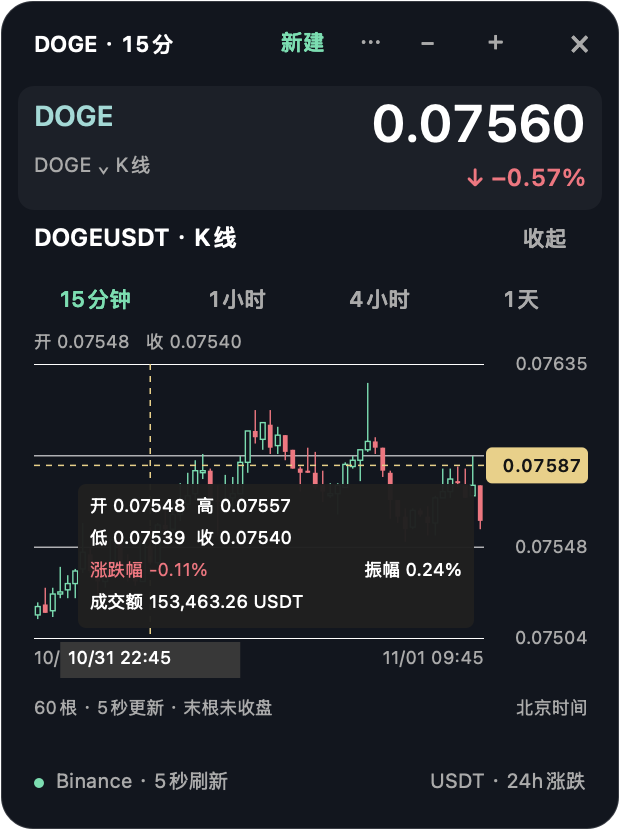

# Crypto Pulse Mini

macOS 桌面置顶 BTC / ETH / PENDLE 行情工具，使用 Binance 公开行情接口，不需要 API 密钥。

支持多窗口：主窗口固定显示 BTC、ETH、PENDLE；点击窗口顶部「新建」，或再次打开应用 / 点击 Dock 图标，即可输入其他币种，创建独立的 USDT 现货行情窗口。支持币种简称（如 SOL、DOGE）和交易对（如 SOL/USDT），打开前会确认交易对可用。

- 单币窗口可以分别拖动、缩放、展开 K 线和选择周期；也可重复打开同一币种看不同周期。
- 不设窗口数量上限。每个窗口独立重连，关闭一个不影响其余窗口。
- 退出应用后再启动，会恢复未关闭的单币窗口、位置、大小和 K 线周期。
- 主窗口的 × 只隐藏主窗口；菜单栏或 Dock 右键菜单可「显示主窗口」。完全退出使用菜单里的「退出 Crypto Pulse」。

- BTC、ETH、PENDLE 实时报价与 24 小时涨跌幅，断线时回退为轮询。
- 可分别展开三张 K 线，支持 15 分钟、1 小时、4 小时和日线。
- K 线每 5 秒更新；超时请求自动清理，持续失败时重建会话，休眠唤醒时恢复连接。
- 三张 K 线都收起时也能自动恢复；分别检查每个币的报价，补取缺失行情。
- 请求失败切换 Binance 官方备用地址；全线持续断开时在系统代理和直连之间尝试，设置仅作用于本应用。服务端限流时遵守等待时间。
- 支持拖动、缩放、跨桌面置顶与 Dock 启动。
- 图标采用用户选定的玄青金色交织结形，v1.7 提亮金色。

## 当前窗口操作与十字线

点击窗口顶部「⋯」，或在窗口背景处右键：

- **原窗口切币**：单币窗口选择「切换这个窗口的币种…」。验证成功后更新行情，保留位置、大小、周期、展开状态、置顶与透明度；输入错误不影响原行情。
- **一键排列所有窗口**：按各自所在屏幕安排位置，必要时缩小以避免重叠。菜单栏和 Dock 右键菜单也有入口。
- **独立置顶与透明度**：每个窗口分别设置置顶，以及 60%～100% 不透明度；重启后恢复。
- **贴边吸附**：拖动或缩放松手时，距离屏幕可用区域边缘 24 点以内自动贴边。在「⋯ → 拖到屏幕边缘自动贴齐」中可以单独关闭并保存。
- **K 线十字线**：鼠标移入蜡烛图，横线右侧显示指针高度对应的价格，竖线定位蜡烛，底部显示北京时间；悬浮框显示该根蜡烛的开、高、低、收、涨跌幅、振幅和成交额（USDT）。涨跌幅为 `(收盘−开盘)/开盘×100%`，振幅为 `(最高−最低)/开盘×100%`；末根未收盘时数值随 K 线刷新。移出图表自动隐藏，支持缩放、小价格币种和主窗口多张图。



窗口动作实现见 `source/window-actions.inc.m`。v1.11 修复了原生拖动尚未结束就尝试吸附的问题，改为检测鼠标释放和最终窗口位置后贴齐。验证记录见 [v1.11 验收记录](QA-v1.11-2026-11-01.md)，此前持续测试见 [v1.10 验收记录](QA-v1.10-2026-11-01.md)。

## v1.12 深度验收修复

- 修复正常轮询结果稍旧于推送时，被误报为连接失败并切换线路的问题；异常数据仍会触发重试。
- 排列缩小后的窗口在切币和重启时保持尺寸；缩小按钮不会反而把窗口放大。
- 主窗口三张 K 线的周期和展开状态也会保存并恢复。

运行 `./test.command --deep` 可执行独立原生窗口边界测试，包括 1～30 窗口排列、缩放/切币/重启的尺寸一致性、主图恢复及悬浮边角。详见 [最终深度验收](QA-final-2026-11-01.md)。

## v1.14 BTC 同步榜

点击任意窗口「⋯ → BTC 同步榜…」，或从菜单栏/Dock右键菜单进入。首次进入自动搜索，后续点击“重新搜索”。

- 范围：CoinGecko市值排名前200，排除BTC、稳定币及BTC锚定币；只比较能匹配到币安正在交易的USDT现货。重复简称、没有对应币对或数据不足会跳过，并显示覆盖数量。
- 顶部可切换“15分钟 / 1小时”，两种周期均比较最近24小时：15分钟取97根已收盘K线、计算96个涨跌幅；1小时取25根、计算24个涨跌幅。相邻收盘价计算简单收益率，再计算与BTC的Pearson相关系数。所有币冻结在同一时间网格，不包含未收盘K线；缺失蜡烛不会补零或错位拼接。
- 切换周期自动取消旧搜索、清空旧结果并重新计算；旧请求不能覆盖新周期的结果。
- 默认“仅显示高度同步”：本工具设定相关系数≥0.80，按系数降序取最多10个。不足10个不凑数。
- 取消该勾选可看最接近的10个；低于0.80直接标“未达标”。相关性是过去这段时间的同步程度，不是上涨概率。
- 点击结果“打开”即可创建对应单币行情窗口，K线周期跟随同步榜选择，榜单暂时隐藏，可从同一入口重新查看。
- 市值和分类缓存最多5分钟。个别市值记录超过1小时未更新时跳过，计入“不可用/过期”；仍要求200个唯一排名和ID、第一名新鲜且至少180条记录在1小时内更新，否则停止本次搜索。每次搜索重新取行情。最多4个币同时请求，支持取消、备用地址、限流等待和3分钟超时，不改变其他行情窗口的连接。

验证：`./test.command --screener`（计算与故障回归）、`./test.command --screener-live`（完整真实扫描及结果打开）。见 [v1.14 筛选验收记录](QA-screener-v1.14-2026-11-01.md)，此前记录见 [v1.13](QA-screener-2026-11-01.md)。

## 构建和启动

需要 macOS 13 或更高版本，以及 Xcode Command Line Tools。

```sh
./build.command
open "Crypto Pulse Mini.app"
```

生成的应用可拖入 Dock 固定。菜单栏行情图标提供「重新连接行情」入口。

## 验证

```sh
./test.command
```

回归测试覆盖：卡住的请求、三币种恢复、旧回调污染、正常刷新、连续失败、唤醒及手动重连、切换周期时的请求竞争。测试使用本地模拟，不请求线上行情。

新增覆盖：收起所有图表后的持续失败、备用地址和连接路线、单币种缺失、服务端限流等待。可另运行 `./test.command --live`，用真实公开行情验证三币种报价、K 线、实时流中断后的自动恢复及完整重连；约需 50 秒，需要网络可用。

`./test.command --windows` 使用独立测试应用和设置，验证主窗口加三个单币窗口的真实行情、选币与切币校验、独立缩放/置顶/透明度、十字线坐标、排列/吸附、关闭及退出后恢复，并将界面截图保存到 `.build/`。需要 macOS 桌面会话和网络。

`./test.command --soak` 默认持续 10 分钟，保持主窗口和三个单币窗口的六张图刷新；在独立测试应用中模拟断网，调用唤醒处理，再中断真实推送并原窗口切币。测试窗口隐藏运行，不修改系统网络、不让电脑实际休眠，也不使用正式应用设置。设置 `PULSE_SOAK_SECONDS=86400` 可运行 24 小时版本（需电脑保持唤醒及网络可用）；一次 10 分钟通过不代表 24 小时已验证。

多窗口与选币实现位于 `source/windows.inc.m`，由 `source/main.m` 引入。

v1.9 重点验收及改进：拒绝异常报价时间戳，避免旧 K 线被误标为新数据；修复选币请求中途失败的备用地址切换；新窗口优先使用空位，按目标屏幕调整恢复尺寸。单币窗口标题显示周期，选币列表优先展示最近使用的币种。详见 [测试与产品验收记录](QA-2026-11-01.md)。

## 图标

`assets/CryptoPulse-XuanqingGold.png` 保留选定的原图。当前使用 `assets/CryptoPulse-XuanqingBrightGold.png` 和对应 `.icns`，保留图案与底色、提亮金色；包含多种 Dock/Finder 显示尺寸。图片由内置 imagegen 生成和编辑。构建脚本会把图标打包进应用。

PENDLE 报价及 K 线价格保留四位小数。
